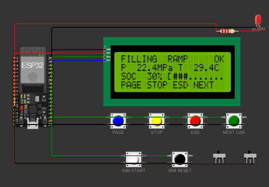
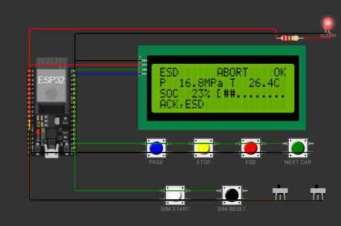
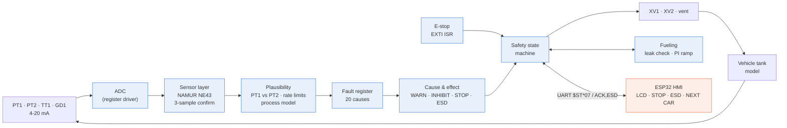
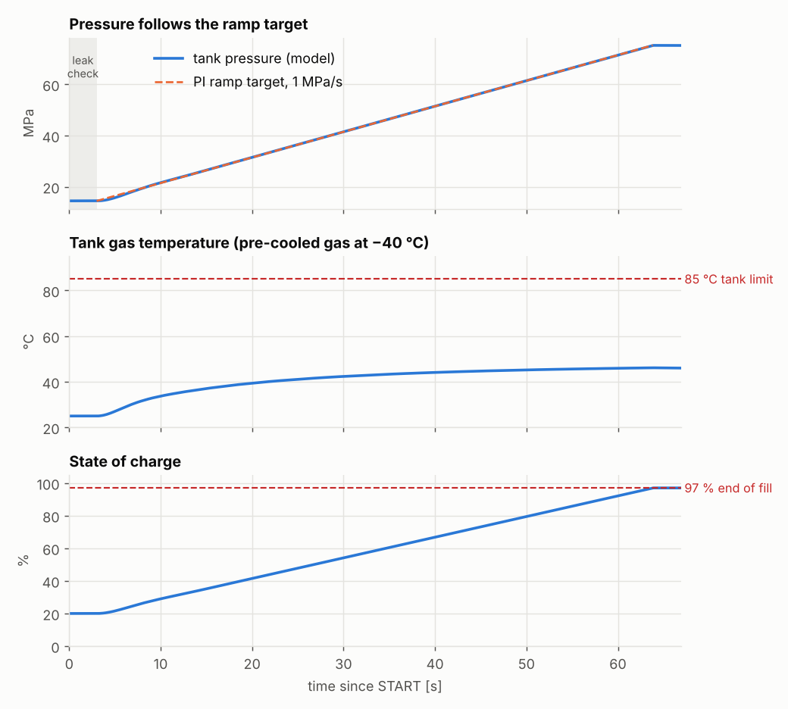
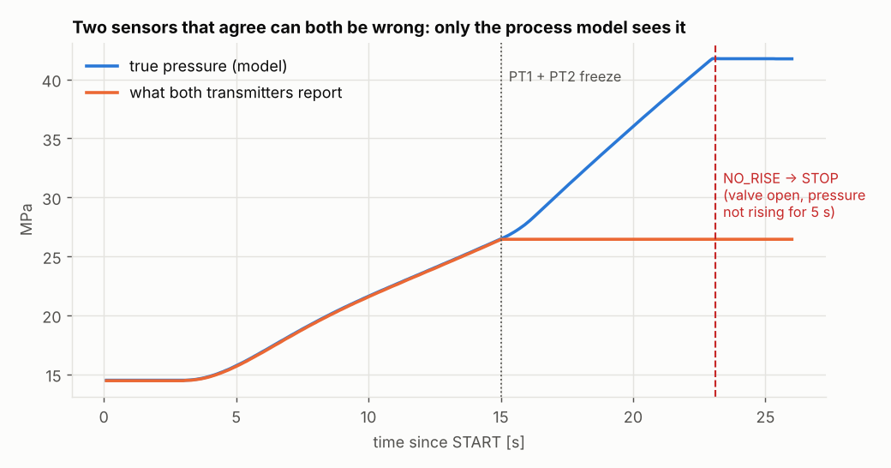
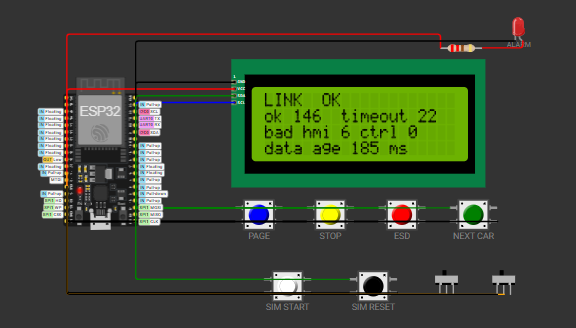

# H₂ Dispenser Controller - STM32 control + ESP32 HMI

**Embedded integration and validation of a hydrogen refueling dispenser, rebuilt end to end in simulation:**
4-20 mA sensors → plausibility → cause & effect → safety state machine → fueling sequence → serial link → operator display - with fault reporting and shutdown coordination along the whole chain.

[](https://github.com/ajkumar-1907/h2-dispenser-controller/actions/workflows/ci.yml)


<p align="center">
  
  
</p>
<p align="center"><i>Left: a fill in the ramp phase - 22.4 MPa, 29.4 °C, 30 %. Right: the operator pressed ESD on the panel - the controller acknowledged (`ACK,ESD`) and went to emergency shutdown.</i></p>

> **What this is - and what it isn't.** During my internship at **Hynics (Animesh Hydrogen Solutions Pvt. Ltd.)** I worked on embedded systems integration and validation for a hydrogen refueling station: evaluating ESP32 vs STM32 for the primary controller, integrating controllers with software interfaces, and validating the chain from sensor input to software display, including fault reporting and shutdown coordination.
> This repository is my **independent, simulated rebuild** of that kind of work, written from scratch to practise and to show the engineering openly. It contains **no Hynics code, drawings, parameters or data**. All limits and models are textbook/demo values, the "car" is a simple physics model, and nothing here is certified or meant for real hydrogen equipment.

---

## Contents
- [The problem](#the-problem) · [Architecture](#architecture) · [Run it in 1 minute](#run-it-in-1-minute)
- [Build it step by step](#build-it-step-by-step) · [Results](#results) · [Safety logic](#safety-logic)
- [Debugging highlights](#debugging-highlights) · [Testing](#testing) · [Design decisions](#design-decisions)
- [Repository layout](#repository-layout) · [Limitations](#limitations)

## The problem

A hydrogen dispenser pushes gas into a car's tank at up to **70 MPa** (700 bar). The controller has to:

1. **Measure** pressure, gas temperature and gas leaks - and know when a measurement *cannot be trusted*.
2. **Decide** what every fault means: warn, block the next fill, stop in sequence, or shut down everything at once.
3. **Fill** the tank fast without overheating it (compression heats the gas; that is why stations pre-cool to −40 °C).
4. **Report** all of it to an operator panel - without ever letting that panel become part of the safety chain.

Which microcontroller should do which part is the first engineering question. The answer, and the reasoning, is in the **[controller evaluation report](docs/controller-evaluation.md)**: **STM32 for deterministic control, ESP32 for monitoring and the HMI.** This repo builds exactly that split.

## Architecture



Blue runs on the **STM32 Nucleo-C031C6**, orange on the **ESP32**. Details, the 10 ms loop and full pin maps: [docs/architecture.md](docs/architecture.md).

## Run it in 1 minute

No hardware needed - everything runs in the browser.

| What | Open | Then try |
|---|---|---|
| **Dispenser controller** (STM32, final) | [Wokwi: Step 5b](https://wokwi.com/projects/480593603046375425) | press **RESET** (the station starts in ESD on purpose - sensors are untrusted until proven), then **START**. Watch the leak check, ramp and end of fill in the serial monitor. Type `$ST*07` to ask for status like the HMI does. |
| **Operator panel** (ESP32) | [Wokwi: Step 6](https://wokwi.com/projects/480597402130418689) | press **SIM START** (the local button at the dispenser), then **STOP** or **ESD** on the panel, **PAGE** through main / alarms / link. Flip the cable-cut switch → LINK LOST. |

To build locally: `tools/build_all.sh` (needs `arduino-cli`, STM32 core 2.12.0, ESP32 core 3.1.3, *LiquidCrystal I2C*). To run the tests: `make -C tests` (needs only `g++`).

## Build it step by step

The controller was built in 12 small steps, each a complete Wokwi project with its own notes: **why** the step exists, what to try, and **which bugs it exposed**. Anyone with basic C can follow it from "read one ADC pin" to a two-board system.

| # | Step | What it adds | Wokwi |
|---|---|---|---|
| 1a | [ADC → mA → MPa](tutorial/step1a_adc_to_milliamps/NOTES.md) | 4-20 mA loop through a 150 Ω shunt | [▶](https://wokwi.com/projects/480581678802888705) |
| 1b | [NE43 status](tutorial/step1b_namur_ne43_status/NOTES.md) | "is this number even valid?" | [▶](https://wokwi.com/projects/480582655817101313) |
| 1c | [Confirm + filter](tutorial/step1c_confirmation_filter/NOTES.md) | noise immunity without slowing fault detection | [▶](https://wokwi.com/projects/480583160625925121) |
| 1d | [Four transmitters](tutorial/step1d_four_transmitters/NOTES.md) | one tested struct for every input, fail-safe start | [▶](https://wokwi.com/projects/480583501788650497) |
| 2a | [Redundant pressure](tutorial/step2a_redundant_pressure/NOTES.md) | PT1 vs PT2: catching a sensor that *looks* healthy | [▶](https://wokwi.com/projects/480584227167506433) |
| 2b | [Rate of change](tutorial/step2b_rate_of_change/NOTES.md) | physics as a plausibility check | [▶](https://wokwi.com/projects/480585016511683585) |
| 3a | [Cause & effect](tutorial/step3a_cause_and_effect/NOTES.md) | fault register, actions, fail-safe valves | [▶](https://wokwi.com/projects/480585616207179777) |
| 3b | [E-stop interrupt](tutorial/step3b_estop_interrupt/NOTES.md) | safety path that doesn't wait for the loop | [▶](https://wokwi.com/projects/480587120335285249) |
| 4 | [Fueling sequence](tutorial/step4_fueling_sequence/NOTES.md) | leak check, PI ramp, tank heating, NO_RISE | [▶](https://wokwi.com/projects/480589443349184513) |
| 5a | [Register-level ADC](tutorial/step5a_register_adc/NOTES.md) | flash 95 % → 85 % | [▶](https://wokwi.com/projects/480593222624966657) |
| 5b | [HMI link](tutorial/step5b_hmi_link/NOTES.md) | framed protocol, checksum, link watchdog | [▶](https://wokwi.com/projects/480593603046375425) |
| 6 | [ESP32 HMI](tutorial/step6_esp32_hmi/NOTES.md) | operator panel, timeouts, remote STOP/ESD | [▶](https://wokwi.com/projects/480597402130418689) |

## Results



| | Wokwi | PC model |
|---|---|---|
| Normal fill, START → 97 % SOC | **63-64 s** | 64.9 s |
| Peak tank temperature with pre-cooling | **44-46 °C** (limit 85) | 46.1 °C |
| Pressure ramp tracking error | **0.1-0.2 MPa** | - |
| E-stop: valves closed in the ISR; loop logged it | **4.45 ms** later | - |
| HMI link, final run | **0 bad frames** in 515-601 | - |
| Flash after the register ADC driver | **95 % → 85 %** | - |

**Why one check is never enough.** Both pressure sensors freeze during a fill. They still *agree*, so the redundancy check is blind - only the process-model check (*valve open, pressure not rising*) notices and stops the fill:



More: pre-cooler failure, the full fault-injection matrix (22 cases) and measured numbers in the **[test report](docs/test-report.md)**.

## Safety logic

Every fault is one bit in a 20-bit register; every bit has exactly one action; the worst action wins.

| Action | Effect | Example causes |
|---|---|---|
| WARN | alarm only | single pressure-sensor wiring, HMI link lost |
| INHIBIT | no new fill | gas 10 %LEL, pre-cooler too warm |
| STOP | XV2 closes, XV1 1 s later; latched | PT1/PT2 disagree, one sensor left, rate faults, tank 85 °C, NO_RISE |
| ESD | all valves closed at once, hose vented; latched | gas 25 %LEL, gas detector blind, no pressure measurement, 87.5 MPa, leak, E-stop, remote ESD |

RESET is local only, refused while the cause is active, and says why. The panel can make the station **safer** (STOP, ESD) but never **less safe** (START, RESET → `NAK,LOCAL_ONLY`). Full matrix, state machine and E-stop path: **[docs/safety-concept.md](docs/safety-concept.md)**.

## Debugging highlights

17 defects were found while testing; every one is written up in the **[debugging log](docs/debugging-log.md)** with symptom, root cause, fix and evidence, and most are now regression tests. Three favourites:

- **The reset that caused its own refusal (#7).** Resetting a sensor-pair fault passed through an "unknown" state for one 10 ms cycle - long enough for the safety logic to see *no pressure measurement* and shut the station down again. Fix: go straight to the correct state.
- **6 bad frames at every fill start (#16).** Only during the 3 s leak check was the status reply 41 characters - one more than the receiver's 40-char buffer. No earlier test had polled status in that phase. Fix: size the buffer from the protocol's **computed worst case (54)**, and test it.

  

- **Flash at 95 % (#14).** Measured instead of guessed: the "print integers instead of floats" idea saved nothing; the HAL ADC path was ≈ 2 KB → replaced by a register-level driver whose every wait has a timeout.

## Testing

```
make -C tests           # 36 host tests: units, every bug as a regression, whole fills on a PC model
make -C tests csv       # scenario CSVs -> docs/data/
python3 tools/make_plots.py
python3 tools/sync_check.py   # shared headers identical everywhere (link.h / faults.h on both boards)
tools/build_all.sh      # compile all 14 sketches
```

The logic headers contain no Arduino calls, so the **exact firmware code** is compiled and tested on a PC ([`tests/station_sim.h`](tests/station_sim.h) re-creates the main loop around them). CI runs all of it on every push.

## Design decisions

| Decision | Why |
|---|---|
| STM32 controls, ESP32 displays | deterministic interrupts, ADC and debug on the control side; Wi-Fi/OS stack kept away from the valves ([report](docs/controller-evaluation.md)) |
| Status from the raw current, value from the filtered one | filtering must never delay fault detection |
| Use the **higher** of PT1/PT2 | an over-pressure check must not be fooled by the lower sensor |
| No rate check on the gas detector | a fast rise *is* what a real leak looks like |
| Start in ESD, first action = RESET | an input is untrusted until it has proven itself |
| Latch + reset with reason | a shutdown must be understood before it is cleared |
| Text protocol with checksum, integers only | readable in any serial monitor, no `printf`/float cost on a 32 KB part |
| HMI link loss = WARN | the HMI must never be needed for the station to be safe |
| Re-arm instead of disabling checks | expected transients (next car) are handled without switching protection off |

## Repository layout

```
firmware/
  stm32_controller/   final controller: sketch.ino + logic headers + hw_adc.h + diagram.json
  esp32_hmi/          operator panel: sketch.ino + sim_controller.h + shared link.h / faults.h
tutorial/             12 steps, each a complete Wokwi project + NOTES.md
tests/                host tests (test_main.cpp), PC model of the loop (station_sim.h), scenarios
tools/                build_all.sh, sync_check.py, make_plots.py
docs/
  controller-evaluation.md   ESP32 vs STM32 report
  architecture.md            layers, loop, pin maps, process model
  safety-concept.md          cause & effect matrix, state machine, E-stop
  protocol-and-hmi.md        frames, timeouts, every HMI screen explained
  debugging-log.md           17 bugs: symptom → cause → fix → evidence
  test-report.md             fault-injection matrix, measurements, plots
  images/ data/
```

## Limitations

- Simulation only (Wokwi + PC model). Interrupt timing in Wokwi is indicative, not a hardware measurement.
- The tank model is ideal-gas and time-scaled; the fueling sequence is *inspired by* H70 protocols, **not** SAE J2601, and the vehicle communication (SAE J2799) is not modelled.
- Not a functional-safety implementation: no SIL claim, no independent hard-wired safety system, no watchdog/brown-out handling yet.
- Two fault cases (pre-cooler failure mid-fill, hose leak) are verified on the PC model and still to be repeated in Wokwi.
- Next steps I'd take: hardware watchdog + safe-state on reset, ADC by timer-triggered DMA, FDCAN to station equipment on a larger STM32, MQTT telemetry from the ESP32.

## Author

**Anuj Kumar** - [github.com/ajkumar-1907](https://github.com/ajkumar-1907)
MIT licensed - see [LICENSE](LICENSE).
