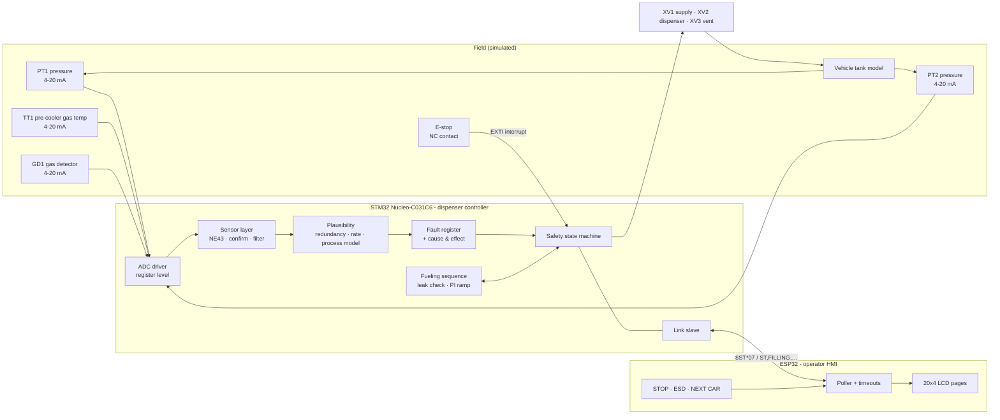
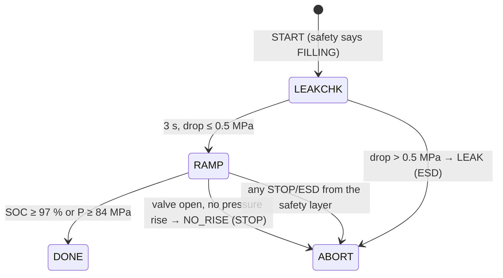

# Architecture

## The station chain this project models



**Design rule:** information flows *up* to the HMI freely; commands flow *down* only if they make the station safer. Everything that can open a valve lives on the STM32.

## Layers on the controller

| Layer | File | Pure C++ (host-tested) | Job |
|---|---|---|---|
| ADC driver | `hw_adc.h` | no (registers) | counts, or `0xFFFF` on timeout |
| Sensor | `sensor_420.h` | ✔ | counts → mA → value; NE43 status, 3-sample confirm, low-pass value |
| Redundancy | `redundancy.h` | ✔ | PT1 vs PT2: OK / DEGRADED / DISAGREE / LOST |
| Rate check | `rate_check.h` | ✔ | physics limits per signal; re-arm on expected jumps |
| Faults + C&E | `faults.h` | ✔ | 20-bit register; action per bit; worst action |
| Safety | `safety.h` | ✔ | states, latching, reset rules, valve outputs |
| Fueling | `fueling.h` | ✔ | leak check, PI pressure ramp, NO_RISE, end of fill |
| Vehicle | `tank_model.h` | ✔ | simulated car tank (stands in for real hardware) |
| Link | `link.h` | ✔ | framing, checksum, building replies without `printf` |
| Main loop | `sketch.ino` | - | 10 ms tick: measure → commands → faults → safety → fueling → outputs |

Keeping every layer except the ADC driver free of Arduino calls is what makes the [host tests](../tests) possible: the same headers compile for the Nucleo and for the PC.

## The 10 ms loop

```
every 10 ms
  1. measure      ADC → sensorUpdate ×4 → pairUpdate → rateUpdate ×3
  2. commands     HMI frames, local START / STOP / RESET (edges, all logged)
  3. faults       collectFaults() → fault register → log every bit that changed
  4. safety       safetyUpdate(register, start, stop, reset) → state + valve outputs
  5. fueling      only while FILLING: fuelStep() → valve opening u
  6. vehicle      tankStep(u) - the simulated car reacts to OUR valves
  7. outputs      writeOutputs() inside a critical section
every 1 s: status line on the serial monitor
E-stop:   EXTI interrupt, valves to safe state immediately (does not wait for the loop)
```

## Pin map

**STM32 Nucleo-C031C6** (final, Step 5b)

| Pin | Dir | Function |
|---|---|---|
| PA0 | in, analog | Step 1-3: PT1. Step 4+: fault-injection selector (healthy / PT1 cut / PT1 stuck / both stuck) |
| PA1 | in, analog | Step 1-3: PT2. Step 4+: PT2 drift ±20 MPa |
| PA4 | in, analog | TT1 gas temperature after pre-cooler, −50…100 °C |
| PA6 | in, analog | GD1 gas detector, 0…100 %LEL |
| PB3 | in, pull-up | STOP (in IDLE: next car) |
| PB4 | in, pull-up | RESET |
| PB5 | in, pull-up | START |
| PB6 | in, pull-up, EXTI | E-stop loop (NC to GND: LOW = healthy) |
| PB7 | in, pull-up | hose-leak injection switch |
| PC6 | out | fault LED (solid = must act, blinking = warning) |
| PC7 | out | XV1 supply valve (NC: HIGH = open) |
| PA8 | out | XV2 dispenser valve (NC: HIGH = open) |
| PB0 | out | XV3 vent indicator (valve is NO: LED on = venting) |
| PA5 | out | heartbeat (on-board LD4) |
| PA2/PA3 | UART | `Serial` - HMI frames typed in the monitor (Step 5b) |
| PA9/PA10 | UART | `Serial1` - real ESP32 link (change `#define HMI`) |

**ESP32 DevKit V1** (Step 6)

| GPIO | Function |
|---|---|
| 21 / 22 | I²C SDA / SCL → 20×4 LCD (address 0x27) |
| 18 | PAGE |
| 19 | STOP |
| 23 | ESD |
| 5 | NEXT CAR |
| 26 | alarm LED |
| 4 / 15 | simulated *local* START / RESET at the dispenser (Wokwi only) |
| 13 | test switch: inject GAS_WARN + P_DISAGREE |
| 14 | test switch: cut the link cable |
| 17 / 16 | UART2 TX / RX to the STM32 when `USE_SIM_CONTROLLER 0` |

## Process model and fueling

The vehicle tank (`tank_model.h`) is deliberately simple - ideal-gas scaling instead of real-gas tables, time-scaled so a fill takes about a minute:

- flow ∝ valve opening × √(supply − tank pressure), supply bank 90 MPa
- incoming gas is heated by compression: T → γ·T_in (γ = 1.4), and the tank loses heat to ambient
- pressure = 70 MPa × (mass / 5 kg) × (T / 288 K); 100 % SOC = 5 kg at 70 MPa, 15 °C

The fueling sequence (`fueling.h`), simplified from how H70 protocols are structured (not SAE J2601):



The PI controller moves a pressure *target* up at 1 MPa/s and opens the valve to follow it (Kp 0.3, Ki 0.2, anti-windup). In Wokwi the tracking error stayed within 0.1-0.2 MPa.
