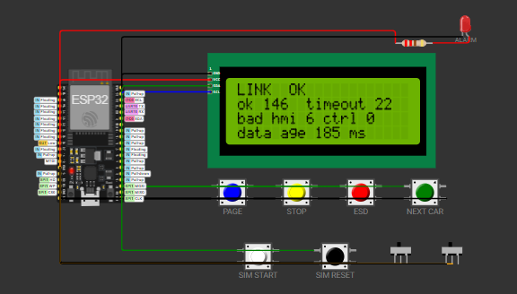
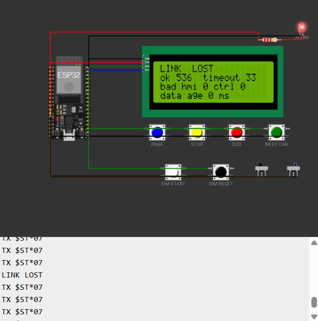

# Debugging log

Every defect found while building and testing the controller in Wokwi, in the order it was found. Each entry: what was seen, the root cause, the fix, and the evidence that the fix holds (most are re-created as host tests in [`tests/test_main.cpp`](../tests/test_main.cpp), named `bugN_…`).

| # | Problem | Step |
|---|---|---|
| [1](#1) | Status flickered on noise | 1c |
| [2](#2) | The filter delayed fault detection and invented values | 1c |
| [3](#3) | Sensors were trusted at power-up | 1d |
| [4](#4) | Both pressure sensors 'OK' while 50 MPa apart | 2a |
| [5](#5) | One state variable hid a second fault | 3a |
| [6](#6) | RESET not audited, repeated while held | 3a |
| [7](#7) | RESET caused its own refusal | 3b |
| [8](#8) | Refusals without a reason | 3b |
| [9](#9) | Limits chattered | 3a |
| [10](#10) | Race: loop re-opened valves after the E-stop ISR closed them | 3b |
| [11](#11) | Next car tripped the rate check | 4 |
| [12](#12) | One button, two meanings; commands not logged | 4 |
| [13](#13) | Regression: RESET-refused message lost | 4 → 5a |
| [14](#14) | Flash at 95 % | 5a |
| [15](#15) | Status reply carries 10 ms-old data | 5b |
| [16](#16) | 6 bad frames + LINK LOST at every fill start | 6 |
| [17](#17) | LCD line overflow and a lying data age | 6 |
| [P](#portability) | ESP32 build: name clashes, struct order | 1d, 6 |

## 1. Status flickered on noise
*Step 1c*

- **Symptom:** Near the 3.6 mA border the status toggled OK ↔ FAULT every few samples.
- **Root cause:** One noisy sample was enough to change the status.
- **Fix:** A new status must be seen 3 samples in a row (30 ms) before it is accepted.
- **Evidence:** `bug1_single_noise_sample_is_ignored`

## 2. The filter delayed fault detection and invented values
*Step 1c*

- **Symptom:** After adding a low-pass filter, a cut cable was reported only after the filtered current had slid down through the bands, and on the way down the status passed through UNDER - a state the cable never had.
- **Root cause:** The status was classified from the *filtered* current.
- **Fix:** Classify the **raw** current; filter only the value that is displayed and controlled on.
- **Evidence:** `bug2_filter_does_not_delay_fault`

## 3. Sensors were trusted at power-up
*Step 1d*

- **Symptom:** Right after reset every sensor was 'OK' before a single sample had been checked.
- **Root cause:** The default status (0) was `SNS_OK`.
- **Fix:** New first enum value `SNS_INIT` = 0: a sensor is *not usable* until 3 good samples. The station therefore starts in ESD and the operator's first action is RESET - fail-safe by construction.
- **Evidence:** `bug3_sensor_starts_untrusted`

## 4. Both pressure sensors 'OK' while 50 MPa apart
*Step 2a*

- **Symptom:** PT1 = 30 MPa, PT2 = 80 MPa, both reported healthy.
- **Root cause:** Each signal was only checked on its own (NE43 band). A drifted transmitter is still inside 4-20 mA.
- **Fix:** `SensorPair`: > 2 MPa for > 500 ms = DISAGREE (latched); use the higher value.
- **Evidence:** `bug4_pair_detects_disagreement`

## 5. One state variable hid a second fault
*Step 3a*

- **Symptom:** With GAS_WARN active, a pressure fault did not show up in the log.
- **Root cause:** A single `state` variable can only hold one cause.
- **Fix:** 32-bit **fault register**, one bit per cause; `worstAction()` over all bits.
- **Evidence:** `bug5_register_keeps_second_fault_visible`

## 6. RESET not audited, repeated while held
*Step 3a*

- **Symptom:** Holding RESET re-ran the reset every 10 ms; nothing in the log said who reset what.
- **Root cause:** Level-triggered button read, no logging.
- **Fix:** Edge detection (`pressedEdge`) and a log line for every operator command.
- **Evidence:** Wokwi log: one `RESET pressed` per press

## 7. RESET caused its own refusal
*Step 3b*

- **Symptom:** After a DISAGREE, pressing RESET with agreeing sensors… went straight back to ESD.
- **Root cause:** `pairReset()` set the pair to `PAIR_INIT` first. For one 10 ms cycle the fault logic saw *no pressure measurement* (`P_LOST` → ESD), so the reset re-tripped the station it had just cleared.
- **Fix:** Reset goes **directly** to OK / DEGRADED / LOST based on the current sensors.
- **Evidence:** `bug7_pair_reset_goes_direct_never_init`

## 8. Refusals without a reason
*Step 3b*

- **Symptom:** `START refused` with no reason - or `active:` followed by an empty list when the cause had already cleared but the shutdown was latched.
- **Root cause:** Only *active* faults were printed; a latched state with no active cause had nothing to print.
- **Fix:** Print the blocking reasons; if no cause is active say `shutdown is LATCHED -> press RESET first`.
- **Evidence:** `bug8_reset_refused_while_cause_active_and_latched_after`

## 9. Limits chattered
*Step 3a*

- **Symptom:** Pressure hovering at 87.5 MPa made OVERPRESSURE go on/off many times a second.
- **Root cause:** A single threshold with noise around it.
- **Fix:** Hysteresis: trip at 87.5 MPa, clear below 85 (tank 85/80 °C, gas 10/8 and 25/23 %LEL).
- **Evidence:** `bug9_overpressure_hysteresis_no_chatter`; Wokwi: trip 87.5, clear 85 confirmed

## 10. Race: loop re-opened valves after the E-stop ISR closed them
*Step 3b*

- **Symptom:** Found while reviewing the E-stop design: if the interrupt fires while the loop is half-way through writing the valve pins, the loop finishes its write with the *old* state and re-opens a valve the ISR had just closed.
- **Root cause:** `writeOutputs()` could be interrupted between reading the state and writing the pins.
- **Fix:** `noInterrupts()` around the output write, and outputs forced safe while `estopTripped` is set.
- **Evidence:** design review + Wokwi E-stop runs; the ISR path is hardware-specific, so it is not in the host tests

## 11. Next car tripped the rate check
*Step 4*

- **Symptom:** Disconnect a full car (84 MPa), connect an empty one (14 MPa) → `PT1_RATE` and `PT2_RATE` → STOP.
- **Root cause:** A 70 MPa step in 10 ms looks exactly like a broken signal.
- **Fix:** `rateRearm()` at the *expected* transient: the window restarts, the check stays **active**. (Disabling it would have been the wrong fix.)
- **Evidence:** `bug11_next_car_jump_with_rearm_does_not_trip` (also proves the trip without the re-arm)

## 12. One button, two meanings; commands not logged
*Step 4*

- **Symptom:** STOP in IDLE meant 'next car', STOP while filling meant 'stop'. Reading the log afterwards you could not tell which happened.
- **Root cause:** Overloaded input and no command audit trail.
- **Fix:** Every command is logged with a timestamp; the HMI (Step 6) has a dedicated NEXT CAR button, and `NC` is refused unless IDLE.
- **Evidence:** `sim_controller_same_rules_as_firmware` (`NAK,NC,NOT_IDLE`)

## 13. Regression: RESET-refused message lost
*Step 4 → 5a*

- **Symptom:** After the Step 4 rewrite a refused RESET was silent again (bug #8 had been fixed in 3b).
- **Root cause:** Code was rebuilt from an older copy; nothing tested that message.
- **Fix:** Restored; the behaviour (reset refused while active, latched afterwards) is now a host test so it cannot silently disappear.
- **Evidence:** `bug8_…` test, Step 5a log

## 14. Flash at 95 %
*Step 5a*

- **Symptom:** After Step 4: 31.4 KB of 32 KB used. One more feature would not fit.
- **Root cause:** Measured with the symbol table (`nm --size-sort`): the HAL ADC path was ≈ 2 KB. The first guess - print integers instead of floats - was measured too and **saved nothing** (float formatting was linked anyway).
- **Fix:** Register-level ADC driver with time-limited waits → **85 %**.
- **Evidence:** [build table](../tutorial/README.md)

## 15. Status reply carries 10 ms-old data
*Step 5b*

- **Symptom:** The fault register in an `ST` reply is from the last 10 ms tick, not the instant of the request.
- **Root cause:** Sampling and replying are different tasks.
- **Fix:** Documented as *data age*; the HMI shows its own data age so the operator knows how fresh the screen is.
- **Evidence:** HMI link page: data age 184-440 ms

## 16. 6 bad frames + LINK LOST at every fill start
*Step 6*

- **Symptom:** The HMI counted exactly 6 bad frames and dropped the link every time a fill started - and only then.
- **Root cause:** During LEAKCHK the status frame is `$ST,FILLING,LEAKCHK,145,250,20,00000,0*22` = **41 chars**. The receiver limit was 40 (the sender allowed 64), so every status reply in the 3 s leak check ended in `FR_OVERFLOW`. Earlier tests never polled status during the leak check.
- **Fix:** `FRAME_MAX = 64`; the true worst case was **computed** (54 chars) and is a unit test. Lesson: size buffers from the worst case of the *protocol*, not from the frames you happened to see.
- **Evidence:** `bug16_longest_status_frame_fits`; screenshot below; final run: **bad hmi 0**

## 17. LCD line overflow and a lying data age
*Step 6*

- **Symptom:** Only in LINK LOST the top line wrapped (`LOS` on the next line), and the link page showed `data age 0 ms` while there was no data at all.
- **Root cause:** `LOST` is one char longer than `OK`, and the column budget was never written down; age was computed from a timestamp that was reset.
- **Fix:** Fixed column budget 9 + 7 + 4 = 20; invalid data shows `----`.
- **Evidence:** screenshot below

## P. Portability: ESP32 and Arduino build errors

| Error | Cause | Fix |
|---|---|---|
| `'Sensor' was not declared in this scope` (Step 1d), same for `Btn` (Step 6) | the Arduino IDE inserts auto-generated prototypes above the first function, so types declared later are unknown there | all types at the top of the sketch |
| `expected unqualified-id before numeric constant` on `LINE_MAX` | `LINE_MAX` is a macro in the ESP32's C library (`limits.h`) | renamed `FRAME_MAX` |
| `'link' redeclared as different kind of symbol` | `link()` is a POSIX function the ESP32 toolchain declares | renamed `linkState` |
| `LINK LOST` / `fault ON` immediately at boot | Wokwi slide-switch default position connected the *test* contact | ground moved to pin 3 so the default is normal operation |

## Mistakes on my side while testing (kept for honesty)

- Diagram copied without the RESET button → no way to leave ESD.
- Added `#include "hw_adc.h"` but left the old `analogRead()` calls in place → still 95 % flash.
- Left knobs at 0 mA → station stayed in ESD ('why is START always refused?' - it was telling the truth: GD1 FAULT-OPEN = blind gas detector = ESD).
- TT1 range −50…100 °C makes the pre-cool window (−40…−33 °C) only **0.75 mA** wide → note for real design: pick the transmitter range for the region you need to resolve.

## Observations without a fix

- An operator STOP shows fuel phase `ABORT` (same as a fault stop). Cosmetic, but a real log should separate *operator stop* from *trip*.
- A PT1 cable cut is first reported as `PT1_RATE` (the jump to 0 mA is seen on the first sample) and 20 ms later as `PT1_WIRING` + `P_DEGRADED`. Both independent checks work; the faster one wins. Covered by `scenario_pt1_cable_cut_stops_on_degraded`.
