# Controller ↔ HMI protocol and the operator panel

## Frame format

```
$BODY*HH\n
```
- `BODY`: comma-separated ASCII fields
- `HH`: XOR of every character of BODY, two hex digits (the NMEA idea - readable in any serial monitor, typeable by hand)
- maximum frame 64 chars; worst case actually produced = 54 (computed and unit-tested, see [bug #16](debugging-log.md#16))
- numbers are integers in fixed units (0.1 MPa, 0.1 °C, %) - no floats on the wire, no `printf` on the STM32

Receiver results: `FR_OK` (1), `FR_OVERFLOW` (2), `FR_NO_DOLLAR` (3), `FR_NO_STAR` (4), `FR_BAD_CS` (5). Anything but OK is answered with `NAK,FRAME,<code>` and counted. A truncated frame is **never** parsed.

## Roles

The **HMI is master, the controller is slave**: the controller only ever answers. So two devices never transmit at once, and the HMI always knows which question an answer belongs to (one request in flight).

| Request | Reply | Rule |
|---|---|---|
| `$HB*0A` | `ACK,HB` | heartbeat |
| `$ST*07` | `ST,<state>,<phase>,<P×10>,<T×10>,<SOC%>,<faults hex5>,<bad frames>` | status |
| `$STOP*18` | `ACK,STOP` or `NAK,STOP,NOT_FILLING` | safer → allowed |
| `$ESD*52` | `ACK,ESD` | safer → allowed, latches REMOTE_ESD |
| `NC` | `ACK,NC` or `NAK,NC,NOT_IDLE` | next car only when idle |
| `$START*40` | `NAK,START,LOCAL_ONLY` | less safe → refused |
| `$RESET*55` | `NAK,RESET,LOCAL_ONLY` | less safe → refused |
| anything else | `NAK,UNKNOWN` | counted as bad |

Example status reply during a fill: `$ST,FILLING,RAMP,452,281,63,00000,0*hh` = filling, ramp phase, 45.2 MPa, 28.1 °C, 63 % SOC, no faults, 0 bad frames.

## Timeouts on both ends

| Side | Timer | Result |
|---|---|---|
| Controller | no valid frame for 5 s | `HMI_LINK` → **WARN** (fill continues) |
| HMI | no reply within 250 ms | timeout counted |
| HMI | 3 timeouts in a row | **LINK LOST**: every value shows `----`, alarm LED on |

## Operator panel (ESP32 + 20×4 I²C LCD)

| Page | Content |
|---|---|
| Main | state · phase · link; pressure; tank temp; SOC bar; last command result |
| Alarms | number of active faults, decoded names from the shared `faults.h` |
| Link | frames ok · timeouts · bad (HMI side / controller side) · data age |

Column budget of the top line: `%-9s%-7s%4s` = state 9 + phase 7 + link 4 = 20 (fixed after [bug #17](debugging-log.md#17)).

### Screens from the Wokwi run

| | |
|---|---|
| 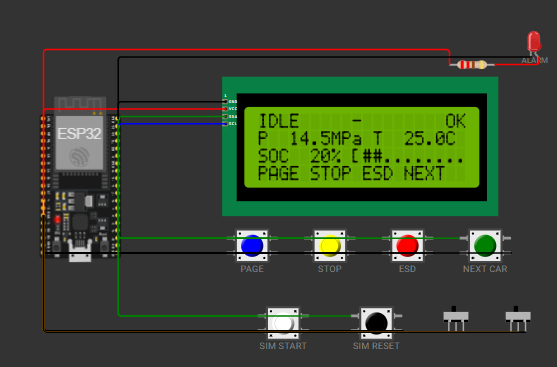<br/>**Idle**, link OK, car at 20 % | 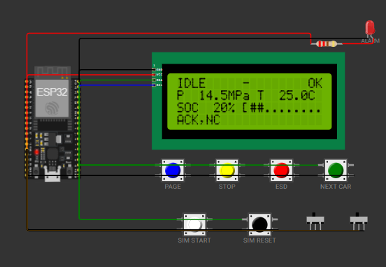<br/>**NEXT CAR** → `ACK,NC` |
| 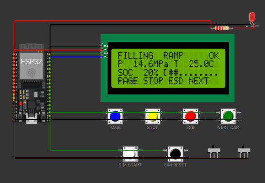<br/>Fill started (local START at the dispenser) | 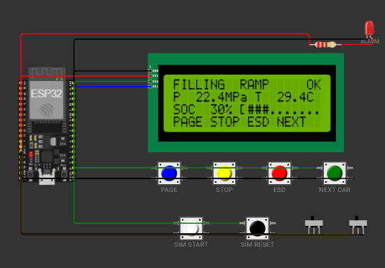<br/>**Ramp**, 22.4 MPa, 30 % |
| 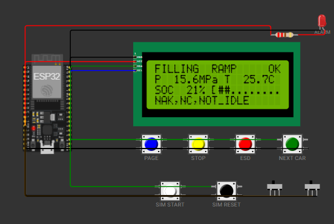<br/>NEXT CAR while filling → `NAK,NC,NOT_IDLE` | 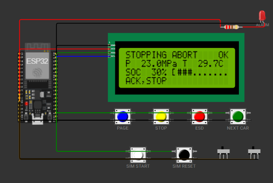<br/>Remote **STOP** → `ACK,STOP`, sequenced stop |
| 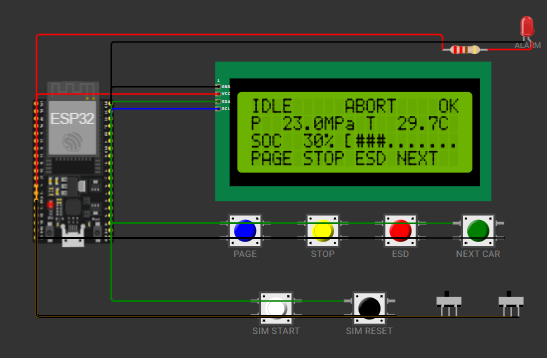<br/>Back to IDLE after the stop | 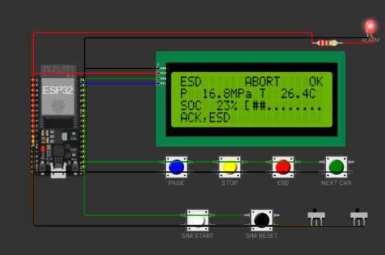<br/>Remote **ESD** → `ACK,ESD`, alarm LED |
| 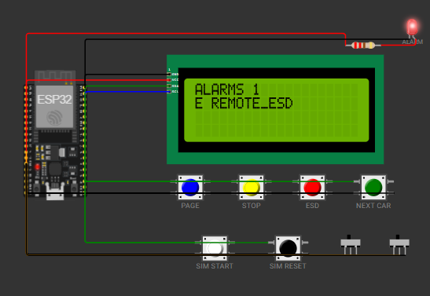<br/>Alarm page: `REMOTE_ESD` | 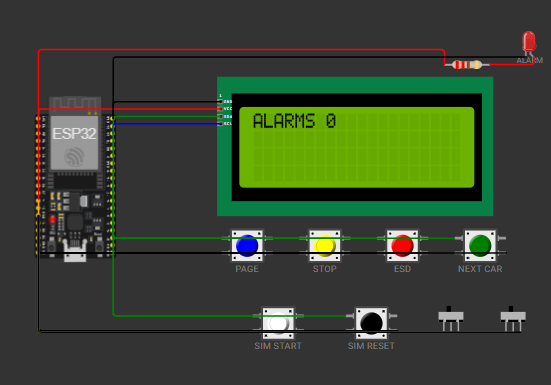<br/>After the **local** reset: 0 alarms |
| 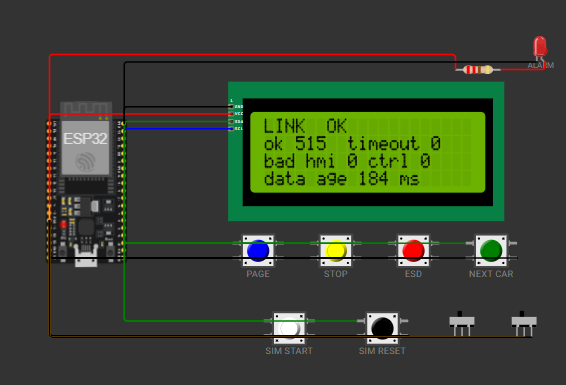<br/>Link page: 515 ok, 0 timeouts, 0 bad | 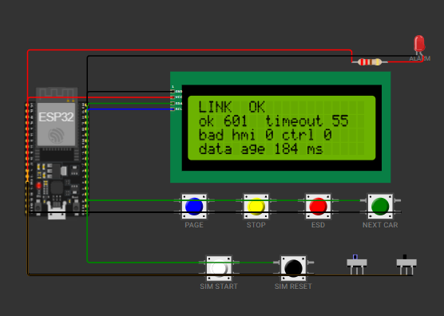<br/>After the cut-cable test: 55 timeouts counted, link recovered |

## Running against a real STM32

In `firmware/esp32_hmi/sketch.ino` set `#define USE_SIM_CONTROLLER 0`; in `firmware/stm32_controller/sketch.ino` change `#define HMI Serial` to `Serial1`. Wire ESP32 GPIO17 (TX) → STM32 PA10 (RX), GPIO16 (RX) ← PA9 (TX), common GND. Both are 3.3 V parts, no level shifter needed.
