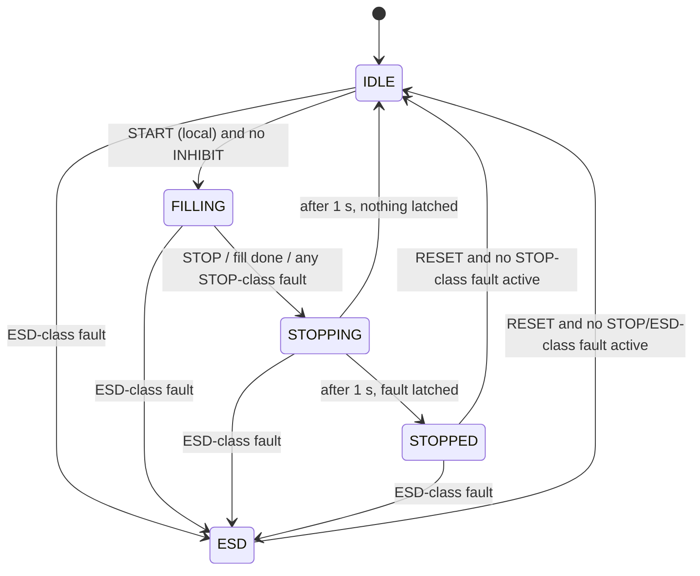

# Safety concept

> Learning project. A real station's safety function is engineered to IEC 61508 / ISO 19880-1 with an independent, hard-wired safety system. What is shown here is the *controller-side* logic and the reasoning behind it.

## Principles

1. **Fail-safe outputs.** Supply XV1 and dispenser XV2 are normally-closed, spring-return: no power = closed. Vent XV3 is normally-open: no power = hose vented. A dead controller is a safe controller.
2. **Fail-safe inputs.** 4-20 mA live zero: a cut cable reads 0 mA = FAULT, never "0 MPa". The E-stop is a normally-closed loop: a cut wire looks exactly like a pressed button. Sensors start in `SNS_INIT` (untrusted).
3. **Defence in depth on the measurement.** Per-signal (NE43 band) → between signals (PT1 vs PT2) → against physics (rate of change) → against the process model (valve open but pressure not rising). Each layer catches failures the others cannot (see the [frozen-sensor test](test-report.md)).
4. **One table decides what happens.** Every cause has exactly one effect, in one function (`faultAction()`), reviewable at a glance.
5. **Latch, then reset with a reason.** STOP and ESD stay until a human presses RESET *at the dispenser*, and RESET is refused while the cause is still active - with the cause printed.
6. **The HMI can only make it safer.** Remote STOP and ESD are accepted; remote START and RESET are refused. Losing the HMI is a warning, not a shutdown.

## Cause & effect matrix

Actions, in increasing severity:
**WARN** alarm only · **INHIBIT** no new fill may start · **STOP** sequenced stop (XV2, then XV1 after 1 s), latched · **ESD** all valves closed at once, hose vented, latched.

| Bit | Cause | Detected by | Action | Why this action |
|---|---|---|---|---|
| 0 | PT1_WIRING | NE43 band, 3 samples | WARN | the pair state below decides; this bit is for maintenance |
| 1 | PT2_WIRING | NE43 band | WARN | same |
| 2 | TT1_WIRING | NE43 band | STOP | cannot verify gas temperature → cannot fill safely |
| 3 | GD1_WIRING | NE43 band | **ESD** | a blind gas detector must be treated as gas present |
| 4 | P_DEGRADED | only one pressure sensor usable | STOP | no redundancy left on the most critical value |
| 5 | P_DISAGREE | \|PT1−PT2\| > 2 MPa for 500 ms | STOP | one of them is lying, unknown which |
| 6 | P_LOST | no usable pressure sensor | **ESD** | filling blind at 70 MPa |
| 7 | PT1_RATE | > 20 MPa/s | STOP | signal broken |
| 8 | PT2_RATE | > 20 MPa/s | STOP | signal broken |
| 9 | TT1_RATE | > 5 °C/s | STOP | signal broken |
| 10 | GAS_WARN | GD1 ≥ 10 %LEL (clear < 8) | INHIBIT | something is leaking a little: don't start |
| 11 | GAS_ALARM | GD1 ≥ 25 %LEL (clear < 23) | **ESD** | |
| 12 | OVERPRESSURE | P ≥ 87.5 MPa (clear < 85) | **ESD** | above the H70 maximum operating pressure |
| 13 | TANK_OVERTEMP | vehicle tank ≥ 85 °C (clear < 80) | STOP | tank material limit |
| 14 | ESTOP | E-stop loop open (EXTI ISR) | **ESD** | |
| 15 | LEAK | leak check: > 0.5 MPa drop in 3 s | **ESD** | hose/receptacle leaking under pressure |
| 16 | NO_RISE | valve ≥ 20 % open, < 0.5 MPa rise in 5 s | STOP | measurement or process is not what we think |
| 17 | PRECOOL | gas warmer than −33 °C | INHIBIT | a fill without pre-cooling overheats the tank |
| 18 | HMI_LINK | no valid frame for 5 s | WARN | safety must not depend on the HMI |
| 19 | REMOTE_ESD | `ESD` command from the HMI | **ESD** | latched; needs a **local** reset |

Several faults at once → the most severe action wins (`worstAction()`). All active bits are logged as they appear and clear (log format, example timestamps):

```
[41230 ms] FAULT+ GAS_ALARM  -> ESD
[41230 ms] STATE FILLING -> ESD
[52010 ms] RESET pressed
[52010 ms] RESET refused, still active: GAS_ALARM
```

## Safety state machine



| State | XV1 supply | XV2 dispenser | XV3 vent |
|---|---|---|---|
| IDLE | closed | closed | closed |
| FILLING | open | open | closed |
| STOPPING | open | **closed first** | closed |
| STOPPED | closed | closed | closed |
| ESD | closed | closed | **venting** |

Outputs are a pure function of the state (`safety.h`), so there is exactly one place that decides what a valve does.

## E-stop path

```
E-stop pressed / cable cut  →  PB6 goes HIGH  →  EXTI interrupt
   estopISR():  XV1 = LOW, XV2 = LOW, VENT = ON     ← valves safe here, inside the ISR
                estopTripped = true (volatile)
main loop (≤ 10 ms later): FLT_ESTOP → ESD state, log line
writeOutputs(): noInterrupts(); if (estopTripped) keep everything safe; interrupts();
```

Measured in Wokwi: the log line followed the ISR by **4.45 ms**; the valves had already closed.
