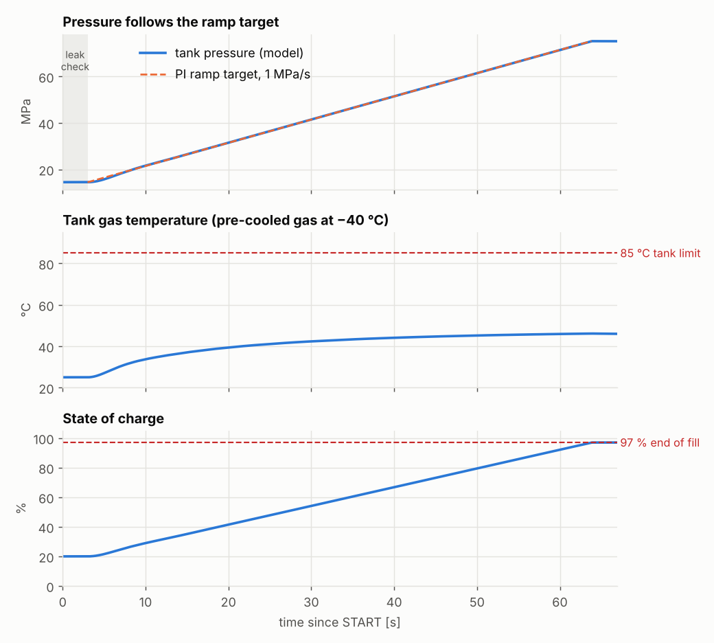
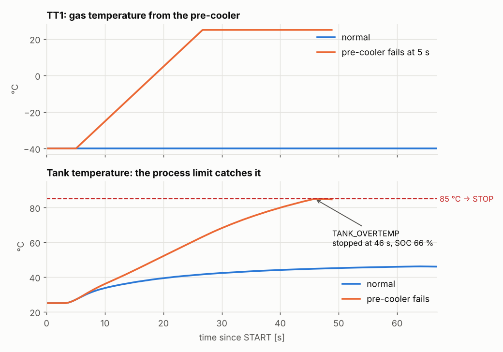
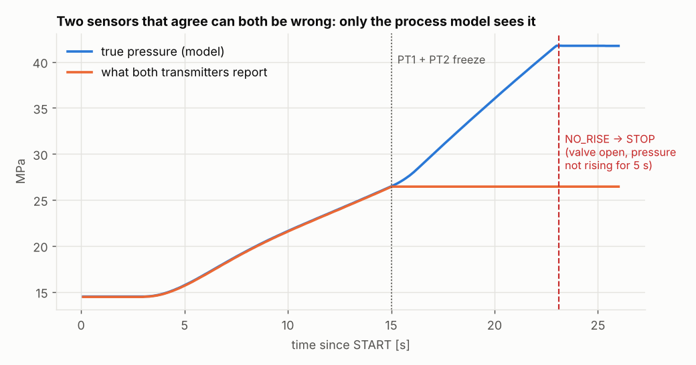

# Test report

Three kinds of evidence back every claim in this repository:

| Kind | Where | What it proves |
|---|---|---|
| **Wokwi runs** | each step's `NOTES.md`, screenshots in [`images/`](images) | the firmware behaves on the simulated board with real pins, interrupts, UART and LCD |
| **Host tests** | [`tests/test_main.cpp`](../tests/test_main.cpp) - 36 tests, 168 checks | the logic headers, the regression of every bug, whole fills on a PC model |
| **Builds** | [`tools/build_all.sh`](../tools/build_all.sh) | all 14 sketches compile (STM32 core 2.12.0, ESP32 core 3.1.3) |

All three run in [CI](../.github/workflows/ci.yml) on every push.

## Fault-injection matrix

| # | Injected fault | How | Expected | Result | Evidence |
|---|---|---|---|---|---|
| 1 | PT1 cable cut | knob to 0 mA / zone A | FAULT-OPEN → P_DEGRADED → STOP | ✔ (rate check fires 20 ms earlier, see note) | Wokwi 2a, 4 · `scenario_pt1_cable_cut…` |
| 2 | PT2 drifts | PA1 knob | DISAGREE after 0.5 s, latched, STOP | ✔ | Wokwi 2a, 4 · `bug4_…` · `pt2_drift.csv` |
| 3 | PT1 stuck | zone C | DISAGREE as soon as the real pressure moves away | ✔ | `scenario_pt1_stuck_disagrees…` (Wokwi zone C available) |
| 4 | **PT1 and PT2 stuck** | zone D | redundancy blind (they agree) → NO_RISE → STOP | ✔ | Wokwi 4 · `scenario_both_sensors_frozen…` |
| 5 | Pressure jump | snap knob | PT_RATE → STOP | ✔ | Wokwi 2b · `rate_check_trips…` |
| 6 | Expected jump (next car) | STOP in IDLE | **no** trip (re-armed) | ✔ | Wokwi 4 · `bug11_…` |
| 7 | Gas 10-25 %LEL | GD1 knob | GAS_WARN → INHIBIT | ✔ | Wokwi 3a · `scenario_gas_warn_inhibits_start` |
| 8 | Gas > 25 %LEL | GD1 knob | GAS_ALARM → ESD, vent | ✔ | Wokwi 3a · `scenario_gas_alarm…` |
| 9 | Gas detector cable cut | GD1 to 0 mA | ESD (blind detector) | ✔ | Wokwi 3a-4 (knob at 0 kept the station in ESD) · `scenario_gas_detector_cable_cut…` |
| 10 | Over-pressure | PT knobs ≥ 87.5 | ESD; clears below 85 | ✔ | Wokwi 3a · `bug9_…` |
| 11 | E-stop | button / cut wire | ESD from the ISR, loop logs 4.45 ms later | ✔ | Wokwi 3b · `scenario_estop` |
| 12 | RESET while cause active | RESET | refused, reason printed | ✔ | Wokwi 3b, 5a · `bug8_…` |
| 13 | Pre-cooler too warm at START | TT1 knob | START refused: PRECOOL | ✔ | Wokwi 4 · `scenario_precool_too_warm…` |
| 14 | **Pre-cooler fails mid-fill** | TT1 warms 3 °C/s | TANK_OVERTEMP → STOP at 85 °C | ✔ PC model: STOP at 46 s, SOC 66 % | `scenario_precool_failure…` · **Wokwi run pending** |
| 15 | **Hose leak** | leak switch on | LEAK in leak check → ESD, vent | ✔ PC model: ESD at 3.7 s | `scenario_hose_leak…` · **Wokwi run pending** |
| 16 | HMI silent 5 s | stop sending | HMI_LINK = WARN, fill continues | ✔ trips at exactly 5000 ms | Wokwi 5b |
| 17 | Bad checksum | `$ST*08` | `NAK,FRAME,5`, counted | ✔ | Wokwi 5b · `link_error_codes` |
| 18 | Over-long frame | 90 chars | `FR_OVERFLOW`, never parsed, receiver recovers | ✔ | `link_overflow…` |
| 19 | Remote START / RESET | HMI | `NAK,…,LOCAL_ONLY` | ✔ | Wokwi 5b, 6 · `sim_controller_same_rules…` |
| 20 | Remote ESD | HMI ESD button | ESD, latched until **local** reset | ✔ | Wokwi 6 (screens) · `sim_controller_same_rules…` |
| 21 | Cable cut HMI ↔ controller | test switch | 3 timeouts → LINK LOST, values `----` | ✔ | Wokwi 6 · `sim_controller_cut_cable…` |
| 22 | Status polled during leak check | normal fill | 0 bad frames | ✔ after fix (was 6 + LINK LOST) | Wokwi 6 · `bug16_…` |

**Pending:** rows 14 and 15 are verified on the PC model (same firmware headers) but have not yet been repeated in Wokwi.

**Note on row 1:** a cut PT1 cable is reported first as `PT1_RATE` (the step to 0 mA is seen on the first sample) and 20 ms later as `PT1_WIRING` + `P_DEGRADED`. Two independent checks, the faster one wins - both lead to STOP.

## Measured results

| Quantity | Wokwi | PC model |
|---|---|---|
| Normal fill duration (START → done) | 63-64 s | 64.9 s |
| End SOC | 97 % | 97.0 % |
| Max tank temperature, pre-cooled fill | 44-46 °C | 46.1 °C |
| Ramp tracking error | 0.1-0.2 MPa | - |
| E-stop: ISR → loop log | 4.45 ms | - |
| Link watchdog | 5000 ms | - |
| HMI final run | 515-601 frames ok, **0 bad**, data age 184-440 ms | - |
| Frozen sensors before NO_RISE stop | true SOC 27 → 37 %, true P ≈ 28 vs shown 20.3 MPa | true 29.7 vs shown 19.4 MPa |
| Flash, Step 4 → Step 5a | 95 % → 85 % | - |

## Plots (PC model, `make -C tests csv && python3 tools/make_plots.py`)





## Host test output

```
$ make -C tests
PASS ne43_bands
PASS scaling_is_clamped
PASS bug3_sensor_starts_untrusted
PASS bug1_single_noise_sample_is_ignored
PASS bug2_filter_does_not_delay_fault
PASS bug4_pair_detects_disagreement
...
    normal fill: 64.9 s, SOC 97.0 %, Ttank max 46.1 C
    precool failure: STOPPED at SOC 66 %, latched 0x22000
    frozen sensors: true P 29.7 vs shown 19.4 MPa, SOC 26 -> 39 %
    worst-case frame: $ST,STOPPING,LEAKCHK,1000,-500,100,FFFFF,2147483647*04 (54 chars, limit 64)
...
36 tests, 168 checks passed, 0 failed
```
