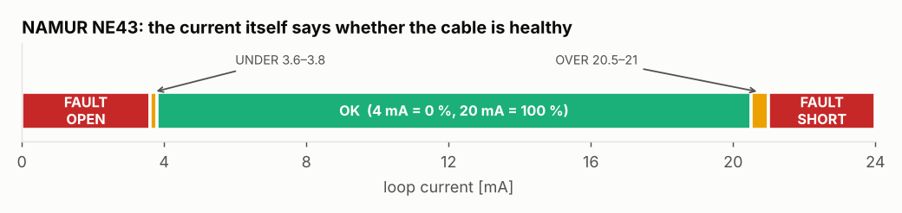

# Step 1b - NAMUR NE43 status + non-blocking timing

▶ **Run it in Wokwi:** [https://wokwi.com/projects/480582655817101313](https://wokwi.com/projects/480582655817101313) · files in this folder: `sketch.ino`, `diagram.json`

## Why this step
A number alone is dangerous: the controller must also know **whether the number can be trusted**. NAMUR NE43 is the process-industry convention for that: currents outside 3.8-20.5 mA are not measurements, they are status signals (and transmitters drive < 3.6 mA or > 21 mA on purpose when they detect an internal fault).

## What you build
- `classify(mA)` → `OK / UNDER / OVER / FAULT-OPEN / FAULT-SHORT` (checks the FAULT bands **first**: 2 mA is also "< 3.8", so testing UNDER first would report a cut cable as merely "under range").
- `maToEng()` **clamps** to 4-20 mA so a slightly-under reading never shows a negative pressure.
- `millis()`-based scheduler: sample every 10 ms, print every 500 ms. No `delay()` - in Step 3 the loop also has to react to buttons and run valves.
- Fault LED on **PC6** lights for FAULT bands.

## Try it
| Knob (mA) | Status | LED |
|---|---|---|
| 0 | FAULT-OPEN | on |
| 3.7 | UNDER | off |
| 12 | OK | off |
| 20.7 | OVER | off |
| 21.5 (max) | FAULT-SHORT | on |

## What I learned / bugs found
- Order of the `if`s is a design decision, not style.
- Non-blocking timing is the basis of everything later: the loop must never wait.

---
[← all steps](../README.md) · [main README](../../README.md)
