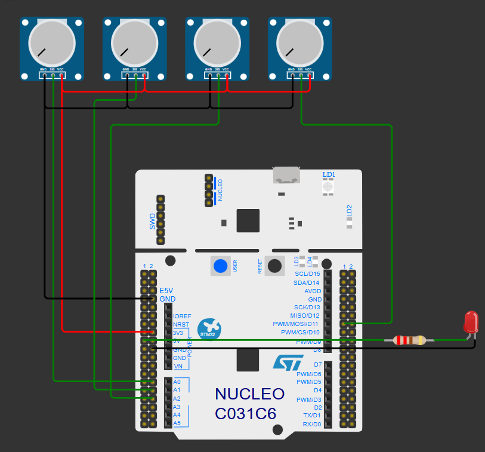

# Step 1d - four transmitters, one struct

▶ **Run it in Wokwi:** [https://wokwi.com/projects/480583501788650497](https://wokwi.com/projects/480583501788650497) · files in this folder: `sketch.ino`, `diagram.json`

## Why this step
A dispenser has many 4-20 mA inputs. Copy-pasting the Step 1c code four times would make four places to get wrong. One `Sensor` struct + one `sensorUpdate()` function = the same tested logic for every input.

## What you build
| Tag | Pin | Range | Meaning |
|---|---|---|---|
| PT1 | PA0 | 0-100 MPa | dispenser pressure, transmitter 1 |
| PT2 | PA1 | 0-100 MPa | dispenser pressure, transmitter 2 (redundant) |
| TT1 | PA4 | −50…100 °C | gas temperature after the pre-cooler |
| GD1 | PA6 | 0-100 %LEL | gas detector in the dispenser housing |

New status **SNS_INIT** = 0: every sensor starts *"not yet proven healthy"* and only becomes OK after 3 good samples. (Fail-safe start: the controller never trusts an input it hasn't checked.) Heartbeat LED PA5 shows the loop is alive.

## Try it
Turn each knob to 0: only that sensor goes FAULT-OPEN; the fault counter per sensor increments once per event.

## What I learned / bugs found
**Arduino gotcha:** the IDE auto-generates function prototypes and puts them *above* your code - so a `struct` declared after the first function is unknown in the prototypes → `'Sensor' was not declared`. Types go at the very top. (Hit again in Step 6 with the `Btn` struct.)

---
[← all steps](../README.md) · [main README](../../README.md)
