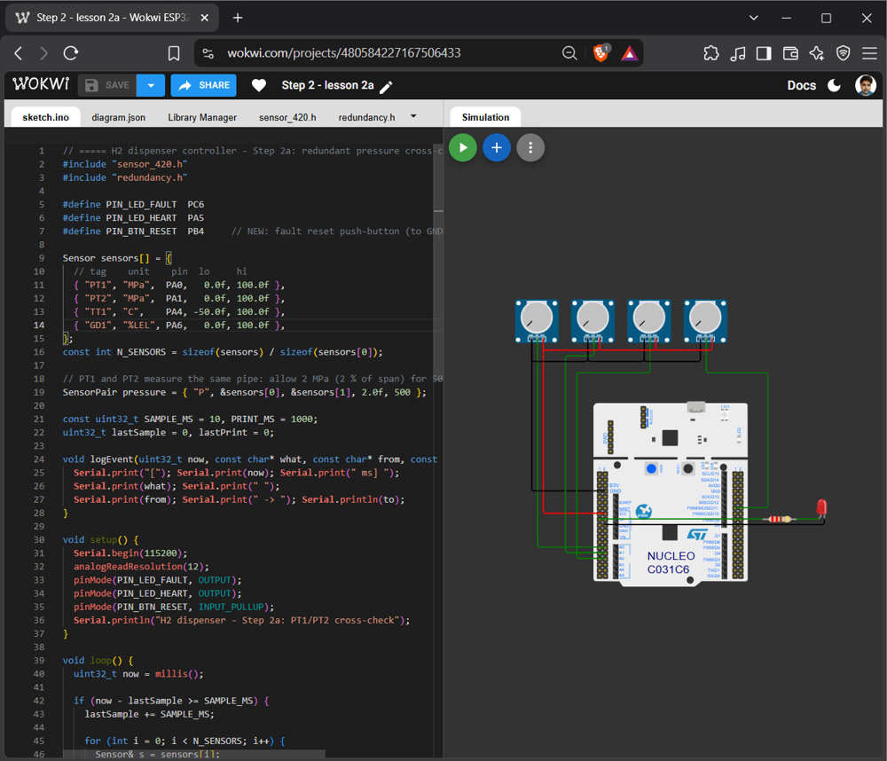

# Step 2a - redundant pressure: are the two sensors telling the truth?

▶ **Run it in Wokwi:** [https://wokwi.com/projects/480584227167506433](https://wokwi.com/projects/480584227167506433) · files in this folder: `sketch.ino`, `diagram.json`, headers

## Why this step
Step 1 catches *broken wires*. It cannot catch a transmitter that is **healthy-looking but wrong** (drifted, stuck, wrong range). Pressure is the most safety-critical value on a 70 MPa dispenser, so it is measured twice (PT1/PT2) and cross-checked.

## What you build
`SensorPair` in [`redundancy.h`](redundancy.h):

| State | Condition | Value used |
|---|---|---|
| OK | both usable, \|PT1−PT2\| ≤ 2 MPa | the **higher** one |
| DISAGREE | both usable, differ > 2 MPa for > 500 ms - **latched** | the higher one |
| DEGRADED | only one usable | the remaining one |
| LOST | none usable | none |

Why the **higher** reading: an over-pressure check must never be fooled by the lower sensor. Why **500 ms**: during fast transients two real sensors can briefly differ. RESET button (PB4) added: DISAGREE clears only if the sensors agree *now*. Headers from here on are plain C++ (no Arduino calls) so they are unit-tested on a PC - see [`tests/`](../../tests).

## Try it
| Do | See |
|---|---|
| PT2 knob 30 MPa away from PT1 | DISAGREE after 0.5 s, stays after you bring it back |
| RESET while still apart | refused |
| RESET after they agree | OK |
| PT1 knob to 0 | DEGRADED, running on PT2 |

## What I learned / bugs found
**Bug #4**: before this step both sensors were "OK" while 50 MPa apart - each one was individually plausible. Plausibility needs *relationships* between signals, not only per-signal limits.

---
[← all steps](../README.md) · [main README](../../README.md)
