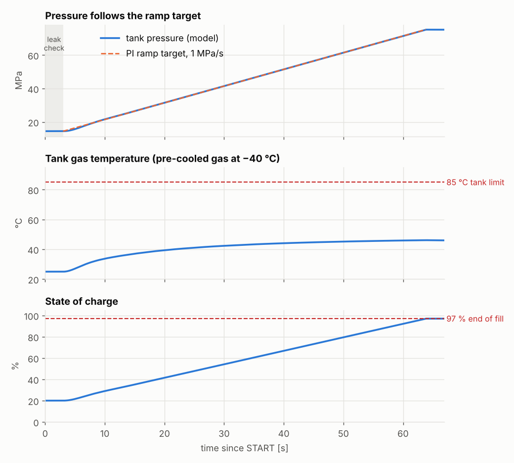
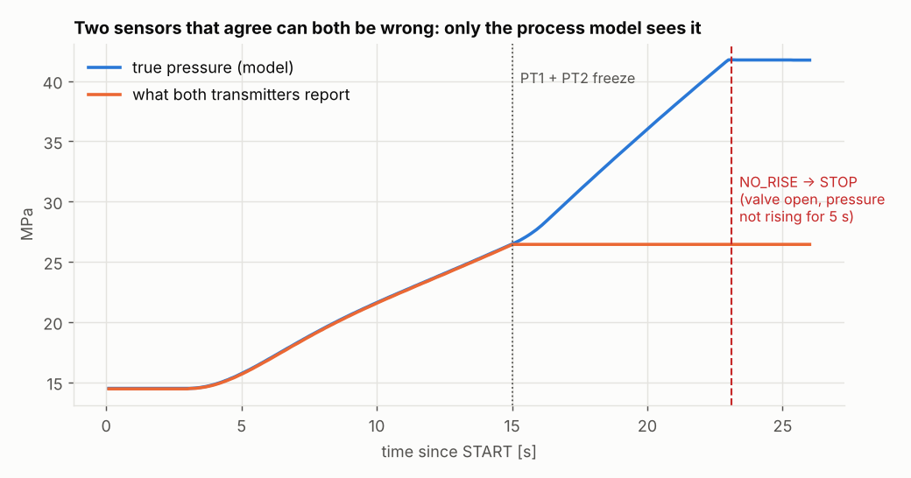

# Step 4 - fueling sequence on a simulated car

▶ **Run it in Wokwi:** [https://wokwi.com/projects/480589443349184513](https://wokwi.com/projects/480589443349184513) · files in this folder: `sketch.ino`, `diagram.json`, headers

## Why this step
Safety logic only matters if there is a process to protect. This step adds a simplified H70 fill: **leak check → pressure ramp under PI control → end at 97 % SOC**, against a simulated vehicle tank that heats up as it fills (compression heating), which is why stations pre-cool the gas to −40 °C. *Inspired by how real protocols are structured; not SAE J2601.*

## What you build
- [`tank_model.h`](tank_model.h): ideal-gas scaling, γ = 1.4 compression heating, cooling to ambient, injectable hose leak. Time-scaled (~1 min fill).
- [`fueling.h`](fueling.h): leak check (3 s, valve closed, max 0.5 MPa drop) → PI ramp at 1 MPa/s → done at 97 % SOC or 84 MPa.
- **Process-model check NO_RISE**: valve > 20 % open but pressure rose < 0.5 MPa in 5 s → STOP. Catches failures that every sensor check misses (see below).
- New faults: LEAK (ESD), NO_RISE (STOP), TANK_OVERTEMP ≥ 85 °C (STOP), PRECOOL gas warmer than −33 °C (INHIBIT start).
- PA0 knob is now a **fault-injection selector** (healthy / PT1 cut / PT1 stuck / both stuck), PA1 is **PT2 drift**, PB7 slide switch = **hose leak**.

## Try it
| Test | Result |
|---|---|
| Normal fill | ~63-64 s, SOC 97 %, Ttank max 44-46 °C, ramp tracking within 0.1-0.2 MPa (Wokwi) |
| Both sensors stuck mid-fill | redundancy says **OK** (they agree!) - NO_RISE stops it; true SOC kept rising 27 → 37 % meanwhile |
| TT1 knob warm, press START | refused: PRECOOL |
| Leak switch ON, START | LEAK in the leak check → ESD *(PC model; Wokwi run pending)* |
| Pre-cooler fails mid-fill | TANK_OVERTEMP → STOP *(PC model; Wokwi run pending)* |

## What I learned / bugs found
**Bug #11**: "next car" made the pressure jump from 84 to 14 MPa → rate check tripped. Fix: `rateRearm()` - restart the measurement window at an *expected* transient. The check stays active (disabling it would be the wrong fix).
**Bug #12**: one STOP button meant both "stop fill" and "next car", and commands were not logged → every command logged; Step 6 gives NEXT CAR its own button.
**Bug #13 (regression)**: the "RESET refused" message from 3b got lost in the Step 4 rewrite → restored, and now covered by a host test so it can't silently disappear again.

---
[← all steps](../README.md) · [main README](../../README.md)
