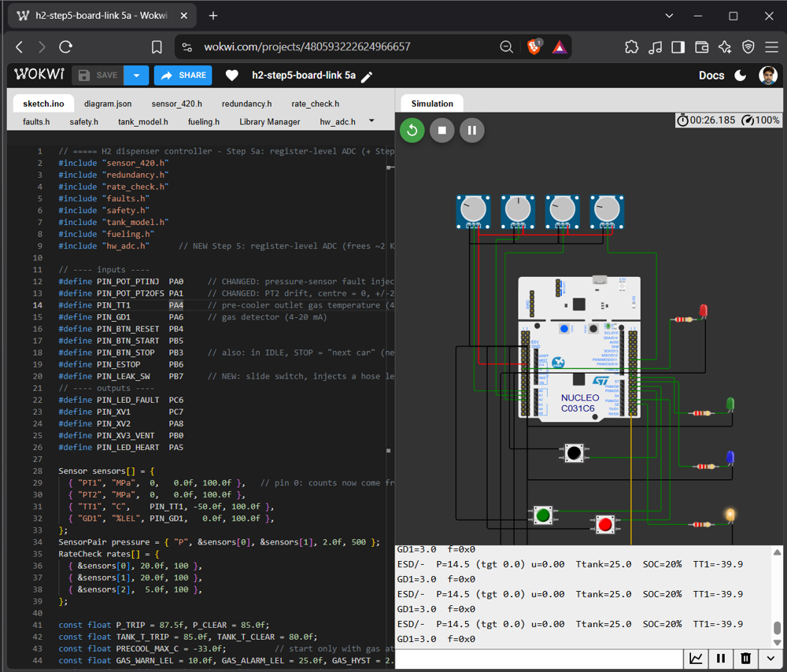

# Step 5b - the controller ↔ HMI link

▶ **Run it in Wokwi:** [https://wokwi.com/projects/480593603046375425](https://wokwi.com/projects/480593603046375425) · files in this folder: `sketch.ino`, `diagram.json`, headers

## Why this step
The STM32 now talks to an operator panel. Design rule from the evaluation: **safety must never depend on the HMI**. The panel may make the station *safer* (STOP, ESD) but never *less safe* (START, RESET are local-only, at the dispenser).

## What you build
[`link.h`](link.h) - `$BODY*HH` frames, XOR checksum (same idea as NMEA), integers only (0.1 MPa, 0.1 °C):

| HMI sends | Controller answers |
|---|---|
| `$HB*0A` | `ACK,HB` |
| `$ST*07` | `ST,FILLING,RAMP,452,281,63,00000,0` (state, phase, P×10, T×10, SOC %, fault register, bad frames) |
| `$STOP*18` | `ACK,STOP` / `NAK,STOP,NOT_FILLING` |
| `$ESD*52` | `ACK,ESD` (latched REMOTE_ESD, needs **local** RESET) |
| `NC` | next car, `NAK,NC,NOT_IDLE` while filling |
| `$START*40`, `$RESET*55` | `NAK,…,LOCAL_ONLY` |
| bad checksum / no `$` / too long | `NAK,FRAME,<code>` + counted |

HMI is master, controller is slave (never talks unsolicited). No valid frame for **5 s → HMI_LINK = WARN only**. You can test it by typing frames into the Wokwi serial monitor.

## Try it
Type `$ST*07` → status frame. Type `$ST*08` → `NAK,FRAME,5`. Stop typing for 5 s → `FAULT+ HMI_LINK -> WARN`, the fill continues (watchdog trips at exactly 5000 ms).

## What I learned / bugs found
**Bug #15**: the status frame carries a fault register that is up to 10 ms old - documented as *data age*; the HMI shows its own age of the data. **Bug #16** (found in Step 6) changed `FRAME_MAX` here.

---
[← all steps](../README.md) · [main README](../../README.md)
