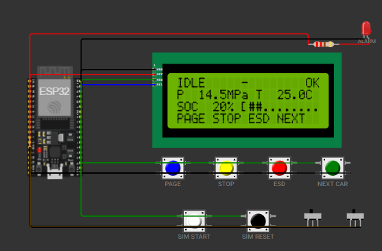
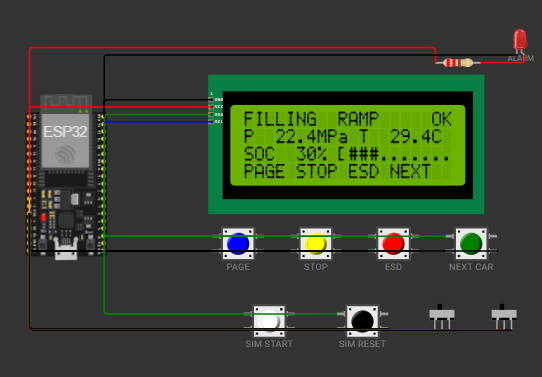
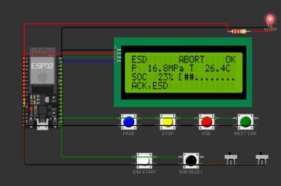
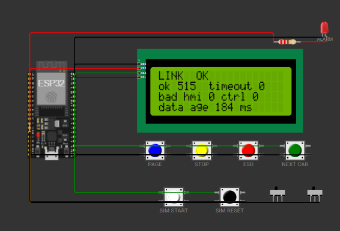

# Step 6 - ESP32 operator HMI

▶ **Run it in Wokwi:** [https://wokwi.com/projects/480597402130418689](https://wokwi.com/projects/480597402130418689) · files in this folder: `sketch.ino`, `diagram.json`, headers

## Why this step
This is the ESP32's job in the architecture: **monitoring and operator interface**, not control. It polls the controller, shows the state on a 20×4 LCD, raises alarms, and sends STOP / ESD / NEXT CAR. On a real station this is also where Wi-Fi/MQTT telemetry would go.

## What you build
- Poll `ST` every 500 ms (doubles as heartbeat), one request in flight, **250 ms reply timeout**, **3 misses → LINK LOST**.
- When data is invalid the display shows `----`, never a stale number.
- HMI-side plausibility on received values (pressure/temperature ranges).
- Pages: main (state/phase, P, T, SOC bar), alarms (decoded fault register, shared `faults.h`), link diagnostics (ok / timeouts / bad frames / data age).
- Buttons: PAGE 18, STOP 19, **ESD 23**, NEXT CAR 5, alarm LED 26.
- Wokwi can't wire two boards, so [`sim_controller.h`](sim_controller.h) runs a stand-in controller inside the ESP32 that speaks **exactly** the same protocol (same `link.h`, `faults.h`). Set `USE_SIM_CONTROLLER 0` for a real STM32 on UART2 (GPIO17 TX → PA10, GPIO16 RX ← PA9).
- Slide switches (test only): inject GAS_WARN + DISAGREE, cut the cable. Both default to *normal operation*.

| | |
|---|---|
|  |  |
|  |  |

## Try it
| Do | See |
|---|---|
| NEXT CAR in IDLE | `ACK,NC` |
| NEXT CAR while filling | `NAK,NC,NOT_IDLE` |
| STOP while filling | `ACK,STOP` → STOPPING → IDLE |
| ESD | `ACK,ESD`, alarm page `REMOTE_ESD`, cleared only by the *local* reset |
| cut-cable switch | 3 timeouts → LINK LOST, values `----` |
| final run | ok 515-601 frames, **0 bad**, data age 184-440 ms |

## What I learned / bugs found
**Bug #16**: 6 bad frames + LINK LOST at *every* fill start. Cause (the `RX BAD FRAME code 2` in the log = `FR_OVERFLOW`): during LEAKCHK the status frame is 41 chars, the receiver limit was 40 (the sender allowed 64) → `FR_OVERFLOW`. Never seen before because no earlier test polled status during the leak check. Fix: `FRAME_MAX 64`, worst case computed = 54 chars, now a unit test.
**Bug #17**: top LCD line overflowed by 1 char only in LINK LOST (`LOS`), and data age showed `0 ms` while the link was down → fixed column budget 9+7+4 and `----`.
**Portability**: `LINE_MAX` is a macro in the ESP32 C library and `link` is a POSIX function - both broke the build → renamed `FRAME_MAX`, `linkState`.

---
[← all steps](../README.md) · [main README](../../README.md)
